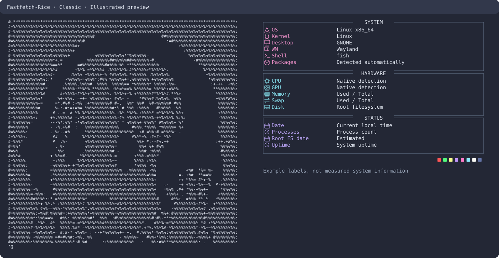

# Fastfetch-Rice

A customizable Linux terminal dashboard / Um painel personalizável para o terminal Linux.

[Português](#português) · [English](#english)

*Illustrated preview — not a runtime screenshot. / Prévia ilustrativa — não é uma captura da execução.*

## Português

### Como baixar e usar

1. [Baixe o ZIP](https://github.com/MoacirJr10/Fastfetch-Rice/archive/refs/heads/main.zip) pelo GitHub (Code → Download ZIP), extraia e abra um terminal na pasta.
2. Instale [Fastfetch](https://github.com/fastfetch-cli/fastfetch#installation), Python 3 e, para os ícones, [JetBrainsMono Nerd Font](https://www.nerdfonts.com/font-downloads). Selecione a fonte nas preferências do terminal.
3. Execute `bash install.sh classic` e confirme. O script instala apenas arquivos locais, sem sudo, com backup.
4. Execute `fastfetch`.

| Tema | Aparência |
| --- | --- |
| classic | ASCII original, magenta, ciano e azul |
| compact | Logo menor e menos informações |
| cyan | Ciano, azul e verde |
| amber | Amarelo, vermelho e magenta |
| plain | Sem ícones Nerd Font |

Mude o tema com `bash install.sh compact` (ou outro nome). Use `--yes` apenas para dispensar a confirmação.

### Personalizar e restaurar

As seções SYSTEM, HARDWARE e STATUS organizam as informações. Substitua o arquivo `ascii.txt` na pasta de configuração do Fastfetch por uma arte sua (no compact, use `ascii-compact.txt`). A arte original tem cerca de 93 colunas; para janelas pequenas, use o tema compact. O instalador respeita XDG_CONFIG_HOME. O disco exibe / por padrão; edite folders para incluir outros pontos de montagem. A CPU, pacotes e swap usam módulos nativos. A data e idade da raiz são estimativas, não a data garantida de instalação. Bateria e ambiente gráfico podem não estar disponíveis.

O instalador não altera wallpaper, fundo transparente, prompt Fish ou tema GNOME. Para iniciar junto do Fish, acrescente `fastfetch` a ~/.config/fish/config.fish somente se desejar; para Bash ou Zsh, aos respectivos arquivos de configuração.

O instalador informa a pasta backup.XXXXXXXX quando substitui arquivos. Copie os arquivos anteriores de volta após conferir o conteúdo. Arquivos novos sem versão anterior podem ser removidos manualmente. Não apague a pasta inteira de configuração.

### Contribuições

Sugestões, temas e correções são bem-vindos! Use Issues e Pull Requests. Compartilhe apenas imagens com direito de redistribuição e remova informações pessoais das capturas. A licença MIT se aplica ao código e à arte geométrica compacta. A arte ASCII principal foi fornecida pelo mantenedor; se derivada de obra externa, sua redistribuição depende da autorização correspondente.

## English

### Download and install

1. [Download ZIP](https://github.com/MoacirJr10/Fastfetch-Rice/archive/refs/heads/main.zip), extract it and open a terminal in the directory.
2. Install [Fastfetch](https://github.com/fastfetch-cli/fastfetch#installation), Python 3 and a [Nerd Font](https://www.nerdfonts.com/font-downloads) (optional for plain).
3. Run `bash install.sh classic` and confirm. Existing files are backed up; no sudo or shell startup changes.
4. Run `fastfetch`. Switch themes using `bash install.sh compact`, cyan, amber or plain.

The classic layout groups modules into SYSTEM, HARDWARE and STATUS. Replace the local logo file with your own artwork. The original ASCII is approximately 93 columns wide; use compact for smaller windows. The installer resolves the logo against your XDG configuration directory. Storage defaults to /; edit folders to add mounts. Root filesystem creation date and age are estimates. Transparency, wallpaper, shell prompt and GNOME settings are independent.

To restore, inspect the backup directory printed by the installer and copy previous files back. Remove newly created files manually if necessary. Contributions are welcome; share only artwork you have permission to redistribute and redact personal details.

The MIT license covers project code and the compact geometric artwork. The main ASCII artwork was supplied by the maintainer; redistribution of underlying third-party artwork requires appropriate permission.

### Validation / Validação

Tests check JSON, Bash syntax and installer behavior with a stubbed Fastfetch in an isolated environment. Runtime compatibility with all distros and versions is not guaranteed. See the official [configuration guide](https://github.com/fastfetch-cli/fastfetch/wiki/Configuration).

MIT © 2026 — [MoacirJr10](https://github.com/MoacirJr10)
